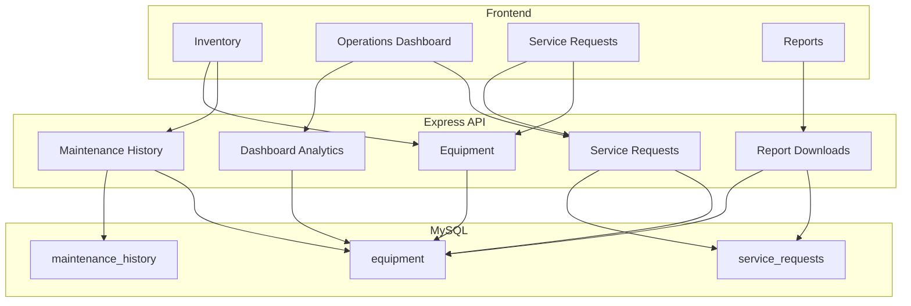

# Biomedical Equipment Records Management System

A biomedical engineering operations application for the equipment fleet: asset registration, maintenance compliance, operational status, equipment support history, and service-request workflows. BERMS turns those records into department-level visibility and operational analytics. It keeps equipment, maintenance, and service-request records only. Patient records, clinical results, and protected health information stay outside this system.

## Overview

This project was inspired by my experience working as a Biomedical Clerk at The Medical City. While supporting biomedical equipment record management activities, I observed how medical devices were tracked through inventories, preventive maintenance schedules, operational status updates, and service documentation.

To strengthen my backend development skills, I developed this Biomedical Equipment Records Management System using Node.js, Express, and MySQL. The application supports the biomedical engineering operations behind that work: registering equipment, monitoring maintenance compliance, keeping equipment support history, moving service requests through a workflow, and reading operational analytics by department and category.

The primary goal of this project was to apply software engineering concepts such as relational database design, RESTful API development, business logic implementation, data validation, and testing within a healthcare operations scenario that reflects processes I have encountered in a professional environment.

Although simplified for learning purposes, the project structure and terminology were influenced by biomedical equipment operations I observed while working in a healthcare environment.

The interface has four views:

- **Inventory** is the equipment inventory. It registers each device and filters the fleet by department, category, operational status, and PM status. Summary cards stay on the full inventory while the table is filtered.
- **Operations Dashboard** is the biomedical operations view. It reports fleet counts, maintenance compliance (PM on schedule, due, and overdue), the on-schedule rate, available and unavailable equipment, open work, and operational analytics by department and category. Department, category, operational status, and service request status filters narrow every card, chart, and list.
- **Service Requests** is the equipment support workflow. A request is opened against a device, with a reporter, a priority, and a problem description, then moved through Open, In Progress, Waiting for Parts, Completed, or Cancelled.
- **Reports** is the reporting center for operations reviews and audits. It downloads inventory, PM schedule, service-request, and operations summary CSV files. Nothing is stored on disk. Each file is generated when it is downloaded.

## Features

- Equipment inventory and asset registration, with required asset tag, serial number, category, manufacturer, model, and clinical department
- Equipment editing, including PM schedule and operational status
- Search across device name, asset tag, serial number, model, manufacturer, category, and department
- Filters for PM status, operational status, device category, PM schedule, and clinical department
- Device categories: Patient Monitor, Infusion Pump, Ventilator, Defibrillator, Diagnostic Imaging, Laboratory Analyzer, Other
- Department-level visibility, with department names collected from the equipment records
- Operational status monitoring: In Service, In Repair, Out of Service, Decommissioned
- Maintenance compliance. PM status is calculated from the next due date as Not Scheduled, On Schedule, Due, or Overdue
- Equipment history kept with the device, including corrective maintenance that records the visit without moving the PM dates
- Work types recorded on that history: preventive maintenance, corrective maintenance, incoming inspection, electrical safety test, and calibration
- Asset registration history written when a device is created, plus notes when the asset tag, serial number, operational status, or PM schedule changes
- Operations dashboard with equipment, maintenance compliance, availability, open-work, and support-demand views, plus slicers for department, category, operational status, and service request status
- Operational analytics by department and by equipment category
- Equipment support workflow with priority (Low, Medium, High) and a required problem description
- Service request statuses: Open, In Progress, Waiting for Parts, Completed, Cancelled
- Reporting center with inventory, PM schedule, service request, and operations summary CSV downloads for operations reviews and audits

## Screenshots

Capture these from a fresh `npm run setup`, at a desktop width of about 1280px, before creating extra devices or requests. Seeded request numbers are `SR-1001`, `SR-1002`, and `SR-1003`. Put the files in `docs/screenshots/` and uncomment the image lines.

### Landing inventory

<!--  -->

`docs/screenshots/01-inventory.png`

The inventory with every seeded device visible, KPI cards filled in, and no filter applied.

### Device record

<!--  -->

`docs/screenshots/02-device-record.png`

The device dialog for VN-208, showing identity, department, operational status, and PM status.

### Maintenance history

<!--  -->

`docs/screenshots/03-maintenance-history.png`

The same device dialog, scrolled to the equipment history and the record-service form.

### Operations dashboard

<!--  -->

`docs/screenshots/04-operations-dashboard.png`

Equipment, preventive maintenance, and service-request cards, plus the department and category tables. Filters at the top narrow every card and chart.

### Service requests

<!--  -->

`docs/screenshots/05-service-requests.png`

The seeded requests, including an open high-priority request and one waiting for parts.

### Report center

<!--  -->

`docs/screenshots/08-report-center.png`

The four operational reports, each with a description, generated date, and download button.

### Search and filtering

<!--  -->

`docs/screenshots/06-search-filtering.png`

PM status set to Overdue. The result line shows the filtered count. The KPI cards still show the full inventory.

### Device status

<!--  -->

`docs/screenshots/07-device-status.png`

The operational status column with In Service, In Repair, and Out of Service visible together.

## Architecture

The browser is a single page. It calls a JSON API. Express validates input, applies the record rules, and reads and writes MySQL through parameterized queries.



```text
server/index.js              Express app and route mounting
server/db.js                 MySQL pool
server/routes/equipment.js   Device CRUD and filtered list
server/routes/history.js     Equipment history
server/routes/requests.js    Service requests
server/routes/summary.js     Equipment, department, and category counts
server/routes/reports.js     CSV report downloads
server/reports.js            Report columns and row mapping
server/csv.js                CSV formatting
server/validate.js           Request checks
server/maintenance.js        PM status rules and filter dates
server/operations.js         On-schedule rate formatting
server/serviceRequests.js    Request numbers, closed dates, and request KPI rules
server/equipmentQuery.js     List SQL
server/present.js            JSON shape
server/http.js               Shared errors and id parsing
server/schema.sql            Tables and sample data
server/setup.js              Applies schema.sql
public/                      Page, styles, and browser script
public/js/dashboardFilter.js Dashboard slicer rules
tests/                       PM rules, history, summary counts, service requests, and report rows
```

## Database

Database: `biomedical_equipment`

Setup creates the database, three tables, and sample devices, history, and service requests. `server/schema.sql` also upgrades an older database in place: renamed categories and statuses are mapped forward, and missing columns are added only when they are absent.

### `equipment`

| Column | Type | Notes |
| --- | --- | --- |
| id | INT | Primary key |
| asset_tag | VARCHAR(50) | Required, unique |
| equipment_name | VARCHAR(100) | Required device name |
| category | ENUM | Patient Monitor, Infusion Pump, Ventilator, Defibrillator, Diagnostic Imaging, Laboratory Analyzer, Other |
| manufacturer | VARCHAR(100) | Required |
| model_number | VARCHAR(100) | Required |
| serial_number | VARCHAR(100) | Required, unique |
| department | VARCHAR(100) | Required clinical department, such as ICU or Radiology |
| operational_status | ENUM | In Service, In Repair, Out of Service, Decommissioned |
| pm_interval | ENUM | Optional. Monthly, Quarterly, Semi-Annual, or Annual |
| purchase_date | DATE | Optional |
| last_maintenance_date | DATE | Last PM date. Optional. Moved only by preventive maintenance, incoming inspection, electrical safety test, or calibration |
| next_maintenance_date | DATE | Next PM due date. Optional. Used to calculate PM status |
| notes | TEXT | Optional |
| created_at | TIMESTAMP | Set on insert |
| updated_at | TIMESTAMP | Set on update |

`asset_tag` and `serial_number` each have a unique index. `next_maintenance_date` is indexed for the PM filter.

### `maintenance_history`

| Column | Type | Notes |
| --- | --- | --- |
| id | INT | Primary key |
| equipment_id | INT | Required foreign key to `equipment.id`. History cannot be deleted, and a device with history cannot be deleted (`ON DELETE RESTRICT`) |
| maintenance_type | ENUM | Preventive Maintenance, Corrective Maintenance, Incoming Inspection, Electrical Safety Test, Calibration, Asset Registration, Operational Status Change, PM Schedule Change |
| maintenance_date | DATE | Service date. Required. Cannot be in the future |
| performed_by | VARCHAR(100) | Required for a service visit. Empty for registration and record changes |
| performed_by_type | ENUM | In-House Engineer or Supplier Engineer. Required for a service visit |
| operational_status | ENUM | Status chosen after a service check. Empty for registration and record changes |
| remarks | VARCHAR(1000) | Findings, or a short note for a record change |
| created_at | TIMESTAMP | Set on insert |

`(equipment_id, maintenance_date)` is indexed for the history list.

### `service_requests`

| Column | Type | Notes |
| --- | --- | --- |
| id | INT | Primary key |
| equipment_id | INT | Required foreign key to `equipment.id` (`ON DELETE RESTRICT`) |
| request_number | VARCHAR(20) | Required, unique. Generated as `SR-` plus the id |
| reported_by | VARCHAR(100) | Required |
| priority | ENUM | Low, Medium, High |
| problem | VARCHAR(1000) | Required |
| status | ENUM | Open, In Progress, Waiting for Parts, Completed, Cancelled. New requests start at Open |
| opened_on | DATE | Required. Cannot be in the future |
| closed_on | DATE | Set when the status becomes Completed or Cancelled. Cleared if the request is moved back to an open status |
| created_at | TIMESTAMP | Set on insert |

`status` and `opened_on` are indexed together. `equipment_id` is indexed.

## API Overview

| Method | Path | Purpose |
| --- | --- | --- |
| GET | `/api/summary` | Equipment counts, PM counts, departments, and counts by department and category |
| GET | `/api/reports` | Report catalog: section, name, description, filename, and generated date |
| GET | `/api/reports/:id` | Download that report as CSV. Ids: `inventory`, `pm-schedule`, `service-requests`, `operations-summary` |
| GET | `/api/equipment` | List devices |
| GET | `/api/equipment/:id` | One device |
| POST | `/api/equipment` | Create a device |
| PUT | `/api/equipment/:id` | Update a device |
| DELETE | `/api/equipment/:id` | Deletes a device only when it has no history. Devices created in the app have a registration row, so this returns `409` |
| GET | `/api/equipment/:id/maintenance` | Equipment history for that device only, newest first |
| POST | `/api/equipment/:id/maintenance` | Add a service record for that device and update its PM dates and operational status |
| GET | `/api/service-requests` | List service requests, newest opened date first |
| POST | `/api/service-requests` | Open a service request |
| PUT | `/api/service-requests/:id` | Change a request status |

Invalid input returns `400`. A duplicate asset tag or serial number returns `409`. A missing device or service request returns `404`. Error responses look like `{ "errors": { "field": "message" } }`. A general problem uses `form`.

List filters are optional query parameters on `GET /api/equipment`:

| Parameter | Behavior |
| --- | --- |
| `q` | Matches asset tag, device name, category, manufacturer, model, serial number, or clinical department |
| `maintenance_status` | `Not Scheduled`, `On Schedule`, `Due`, or `Overdue`. Decommissioned devices are excluded |
| `category` | One of the device categories |
| `operational_status` | One of the operational statuses |
| `department` | Exact clinical department name |
| `pm_interval` | `Monthly`, `Quarterly`, `Semi-Annual`, or `Annual` |

An unknown category, operational status, PM status, or PM schedule returns `400`. Every device JSON object includes `maintenance_status` and `corrective_count`. `corrective_count` is the number of corrective maintenance history rows for that device.

`GET /api/service-requests` accepts an optional `status` query parameter. An unknown status returns `400`.

`GET /api/summary` returns equipment analytics only. Service-request KPI cards, support-demand charts, and open-request age are calculated in the browser from `GET /api/equipment` and `GET /api/service-requests`.

`GET /api/reports` lists the four downloads. `GET /api/reports/:id` builds the CSV in memory and sends it with `Content-Disposition: attachment`. An unknown id returns `404`. Inventory and the PM schedule report use the same unfiltered equipment query and PM status rule as the inventory. The PM schedule report lists every device and every PM status, including Not Scheduled and decommissioned devices, so it is a schedule report rather than a due list. The service request report uses the same request list as Service Requests and adds department, reporter, and problem description. The operations summary uses `buildEquipmentSummary` and `summarizeRequests`. Active equipment is `total` minus `decommissioned`. Available equipment is `in_service`. Unavailable equipment is `in_repair` plus `out_of_service`. PM counts leave out decommissioned devices. `on_schedule_rate` is `current` divided by `current` plus `due_soon` plus `overdue`, and it is `null` when that denominator is zero. Open work is Open plus In Progress plus Waiting for Parts. High priority open work is that same set where priority is High. Completed this month uses the server date. The Device column is the device name and asset tag. Dates are `YYYY-MM-DD`. A blank PM interval, closed date, or on-schedule rate means that value is not set.

```json
{
  "total": 5,
  "in_service": 3,
  "in_repair": 1,
  "out_of_service": 1,
  "decommissioned": 0,
  "due_soon": 1,
  "overdue": 2,
  "current": 1,
  "not_scheduled": 1,
  "available": 3,
  "unavailable": 2,
  "on_schedule_rate": 0.25,
  "departments": ["Emergency Department", "ICU", "Radiology"],
  "by_department": [
    { "department": "Emergency Department", "count": 1 },
    { "department": "ICU", "count": 2 },
    { "department": "Radiology", "count": 2 }
  ],
  "by_category": [
    { "category": "Defibrillator", "count": 1 },
    { "category": "Diagnostic Imaging", "count": 1 },
    { "category": "Infusion Pump", "count": 1 },
    { "category": "Patient Monitor", "count": 1 },
    { "category": "Ventilator", "count": 1 }
  ]
}
```

`due_soon` is the number of devices whose PM status is Due. `current` is the number whose PM status is On Schedule. Decommissioned devices are not included in `due_soon`, `overdue`, `current`, or `not_scheduled`. `available` is In Service. `unavailable` is In Repair plus Out of Service, and decommissioned devices are in neither. `on_schedule_rate` uses only On Schedule, Due, and Overdue. Department and category counts include every device, including decommissioned devices. The device counts add up to `total`. Active equipment on the dashboard is `total` minus `decommissioned`.

`POST /api/equipment/:id/maintenance` accepts `maintenance_type`, `maintenance_date`, `performed_by`, `performed_by_type`, `operational_status`, optional `remarks`, and optional `next_maintenance_date`. `performed_by_type` is `In-House Engineer` or `Supplier Engineer`. Omit `next_maintenance_date` to leave the current next PM date. Send an empty string to clear it. For a preventive maintenance, incoming inspection, electrical safety test, or calibration that is the latest visit, the next PM date follows the device schedule. Those same work types are the only ones that move the last PM date. Corrective maintenance does not.

`POST /api/service-requests` accepts `equipment_id`, `reported_by`, `priority`, `problem`, and `opened_on`. The status is Open. The request number is `SR-` plus the new id, padded to at least three digits. The sample rows use `SR-1001` through `SR-1003`, so a request created after setup can receive a lower number than the samples.

`PUT /api/service-requests/:id` accepts `{ "status": "In Progress" }`. Completed and Cancelled set `closed_on` to the server's current date the first time the request is closed. A later status change keeps that closed date if the request stays completed or cancelled. Open, In Progress, and Waiting for Parts clear `closed_on`.

## Installation

Node.js and a local MySQL server are required.

From the project folder:

```powershell
npm install
copy .env.example .env
npm run setup
npm start
```

On macOS or Linux, use `cp .env.example .env` instead of `copy`.

Open [http://localhost:3000](http://localhost:3000).

Edit `.env` if MySQL is not `root` on `localhost:3306` with an empty password. If setup says the connection was refused, start MySQL and check `DB_HOST`, `DB_PORT`, `DB_USER`, and `DB_PASSWORD`.

| Variable | Local default | Purpose |
| --- | --- | --- |
| `PORT` | `3000` | HTTP port |
| `DB_HOST` | `localhost` | MySQL host |
| `DB_PORT` | `3306` | MySQL port |
| `DB_USER` | `root` | MySQL user |
| `DB_PASSWORD` | empty | MySQL password |
| `DB_NAME` | `biomedical_equipment` | Database name |

`.env` is not committed. `.env.example` lists the same keys with local defaults.

`npm run setup` creates the `biomedical_equipment` database, the tables, and the sample devices, service history, and service requests. It is safe to run again: existing asset tags are left in place, a sample history row is inserted only when that finding is not already stored, and a sample request is inserted only when that request number is not already stored. You can also run [server/schema.sql](server/schema.sql) in a MySQL client.

### Sample records

Dates follow the day setup was last run. Recording a later PM changes the next date, so these descriptions match a fresh setup, not later edits.

| Asset tag | Record |
| --- | --- |
| PM-001 | Semi-annual. PM due. Incoming inspection and PM by M. Santos |
| IP-014 | Quarterly. PM overdue. Emergency Department. Supplier follow-up by P. Garcia. Open request SR-1001 |
| VN-208 | Semi-annual. PM on schedule. Completed request SR-1003 |
| DF-033 | Annual. In repair. PM not scheduled. Request SR-1002 is waiting for parts |
| IMG-017 | Annual. Out of service. PM overdue |

## Development Notes

PM status is calculated from `next_maintenance_date` when a record is read. It is not stored on the device.

| Status | Rule |
| --- | --- |
| Not Scheduled | No next PM date |
| Overdue | Next PM date is before today |
| Due | Next PM date is today or within 30 days |
| On Schedule | Next PM date is more than 30 days away |

The last PM date is updated only by preventive maintenance, an incoming inspection, an electrical safety test, or calibration. A corrective visit does not change it. The last PM date cannot be in the future. If both PM dates are filled in, the last date has to be on or before the next date. A device can still be in service while its PM is overdue. Operational status and PM status are separate. Decommissioned devices are left out of the PM counts.

Equipment history is stored per device in `maintenance_history`. Those rows are not removed. Creating a device writes an asset registration, so a device created here is not deleted. Mark it Decommissioned if it is no longer in use.

The PM schedule is monthly, quarterly, semi-annual, or annual. The latest preventive maintenance, incoming inspection, electrical safety test, or calibration sets the next due date from that schedule and also sets the last PM date. Corrective maintenance does not change either PM date.

A service record updates the device in one transaction. The engineer picks the operational status after the check. Findings are required when that status is not In Service.

Equipment history is listed on the device record, newest first. The counts at the top of the inventory are split into equipment in use and preventive maintenance. Filters are applied in SQL. The counts are for every device, including while the list is filtered.

Changing operational status from the edit form requires notes when the device is not left In Service. Those notes are copied onto the status-change row. A service visit requires findings instead of notes.

Request KPI rules live in `server/serviceRequests.js`. The dashboard applies the same rules in the browser: Open, In Progress, and Waiting for Parts are counted from the request status. Open work is those three statuses added together. High priority open work is that set where priority is High. Completed this month counts Completed requests whose `closed_on` falls in the current month. Cancelled requests are omitted from those cards and from the support-demand counts. The operations summary download uses those same rules on the server.

Dashboard filters run in the browser from `GET /api/equipment` and `GET /api/service-requests`. Department, category, and operational status narrow the equipment. Service requests are limited to that equipment. A service request status also limits the equipment cards and charts to devices that have a request in that status. Inventory filters and the service request page filter stay separate. PM counts still leave out decommissioned devices. Support demand uses the filtered equipment and requests. Requests per active equipment divides non-cancelled requests on active devices by the active device count. Repeated attention lists a device with two or more non-cancelled requests, or two or more corrective maintenance rows. Open request age is today's date in the browser minus `opened_on`, in days, for Open, In Progress, and Waiting for Parts.

Report files are built when someone downloads them. The report center does not write CSV files to disk. Inventory and the PM schedule report follow the unfiltered equipment list and include serial number. The service request report follows the service request list and includes department, reporter, and problem description. The operations summary follows the equipment counts, the on-schedule rate, availability, and the request KPI rules.

Dates use the date on the computer running the server. Set the host timezone before deploying so "today" and "this month" match the site you intend to show.

`npm test` checks the PM status rules, service-record validation, summary counts, request numbers, closed dates, filter SQL, and report row mapping. It does not need MySQL, and it does not call the HTTP routes.

## Limitations

This system keeps a local inventory of devices, the equipment history for each device, and a service-request workflow. It does not cover patients, parts stock, purchasing, supplier contracts, user accounts, or notifications.

There is no login. Anyone who can open the site can add, edit, and record service. Treat a deployed copy as a demonstration, or put a control in front of it at the host.

Creating a device writes an asset registration. The page does not offer delete, because that history stays with the device. `DELETE /api/equipment/:id` still exists and returns `409` when history or a service request references the device. To take a device out of use, set operational status to Decommissioned. Decommissioned devices remain in the list, in the device totals, and in the department and category counts. They are left out of the PM counts and out of a PM status filter.

The last PM date changes only after preventive maintenance, an incoming inspection, an electrical safety test, or calibration. Corrective maintenance records the visit and can change the operational status, but it does not move the last PM date. The next PM date is recalculated from the schedule only for those same four work types, and only when the visit is the latest one.

A department name is plain text. Two spellings of the same place are stored as two departments.

Service request status can move from any status to any other valid status. There is no separate approval step.

`npm test` checks the date rules, service validation, summary grouping, request rules, filter SQL, and report rows. It does not call the HTTP routes against MySQL.

Reports download as CSV only. They are generated for the current records at the moment of download, and they are not saved, scheduled, or emailed.

## Future Enhancements

These are intentionally out of scope for this release.

- A host-level gate in front of a public demo, without adding user accounts to the application
- A production start check that refuses the default empty database password
- Serving the service-request KPI counts from the API, using the rules already in `server/serviceRequests.js`
- A controlled department list, if free-text department names become a problem in the sample data
